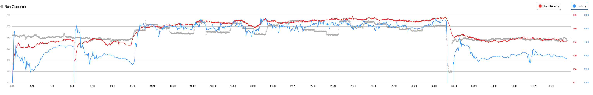

# Cadence-test analysis

## Overview

I made this small repo to try to decide which was my ideal cadence when
running. It all revolves around a workout at sub LT2 speed (which I think is a
good "realistic" speed for racing medium distances).

The workout consists of 10 minutes warmup, followed by 26 consecutive
one-minute segments at a target pace (in my case, 3:55 min/km). Each segment
has a prescribed cadence, and the cadence is different for each segment. I run
in a track field, but probably a treadmill would have been much better,
especially when it comes to holding a constant speed at changing cadences.

The cadence in each segment is dictated by a metronome (file
[`randomized_cadence_26_minutes.mp3`](randomized_cadence_26_minutes.mp3)), which I started exactly after the 10
minutes warmup. Cadences are sampled between 185 and 210 per minute because I
think this covers what I think it will be most efficient for me, based on
previous threshold runs. I recorded the whole workout with a Garmin watch,
which produced a `.fit` file containing timestamped speed, heart-rate, and
power records. I used a HR strap to get a more reliable heart-rate signal. This
is how my workout looks like:

{width=100%}


## Requirements and installation

- Python 3
- Python packages: `fitparse` and `pandas`
- A Garmin FIT activity file containing timestamped speed and heart-rate


## Experimental design

- Warm-up: 10 minutes by default.
- Tempo section: 26 consecutive one-minute segments.
- Target pace during the tempo section: 3:55 min/km.
- Every integer cadence from 185 through 210 beats/min appears once.
- One metronome click corresponds to one step, counting both feet.

The prescribed cadence order is specified in the
[`cadence_schedule.csv`](cadence_schedule.csv) file, which contains Minute,
Start, End, and BPM columns. These are the first lines of the file:

```text
Minute,Start,End,BPM
1,00:00,01:00,193
2,01:00,02:00,203
3,02:00,03:00,197
4,03:00,04:00,188
5,04:00,05:00,187
```
These are the cadence values in chronological order:

```text
193, 203, 197, 188, 187, 207,
190, 189, 205, 196, 186, 202,
206, 210, 194, 191, 185, 209,
199, 208, 204, 198, 195, 192,
200, 201
```

In the downstream analysis, for each segment, the script discards its first 20
seconds and its final 5 seconds. It therefore retains a 35-second analysis
window to account for the time it takes to adjust to the new cadence and to
avoid the final seconds of the segment, which may be affected by the next
cadence change and small lags when starting the metronome.


## Usage of `summarize_cadence_test.py`

Default: first metronome click occurs 600 seconds after the recorded session
start.

```bash
python summarize_cadence_test.py 25030325796_ACTIVITY.fit -o cadence_summary.csv
```
The script will use the [`cadence_scheduce.csv`](cadence_schedule.csv) by
default, in the same directory as the script. If you want to use a different
cadence schedule, you can specify it with the `--cadence-schedule` option. The
file needs to have a header with a column called "BPM".

Custom offset: use the `--tempo-start` option.

To show command-line options:

```bash
python summarize_cadence_test.py --help
```


## Output

The [output CSV](cadence_summary.csv) contains 26 rows and these columns, in this order:

| Column | Description | Unit |
|---|---|---|
| `segment` | Chronological segment index, starting at 1 | Integer |
| `cadence_bpm` | Prescribed metronome cadence, not measured running cadence | Steps/min |
| `pace_min_per_km` | Pace calculated from mean recorded speed in the analysis window | Decimal min/km |
| `heart_rate_bpm` | Mean recorded heart rate in the analysis window | Beats/min |
| `power_w` | Mean recorded standard FIT power in the analysis window | Watts |

Pace is numeric, not a minutes:seconds string. For example, 3:55 min/km is
approximately `3.9167`, not `3.55`.

The script prefers `enhanced_speed`, falling back to `speed` on each record. It
does not estimate speed from GPS coordinates or cumulative distance.

With the default offset:

- Segment 1 (193 steps/min): 10:20 inclusive to 10:55 exclusive.
- Segment 2 (203 steps/min): 11:20 inclusive to 11:55 exclusive.
- Segment 26 (201 steps/min): 35:20 inclusive to 35:55 exclusive.


## Timing and averaging assumptions

- The reference is the earliest recorded session start, falling back to the first data-record timestamp if session start is unavailable.
- The script excludes watch-recorded pauses during the warm-up, both from the records used for analysis and from the timer used to locate the tempo interval.
- Set `--tempo-start` to the actual first-click offset. The script does not automatically detect the tempo section from laps, heart rate, or speed.
- The metronome is assumed to have played continuously from that point. If it was paused or restarted, the fixed segment boundaries need modification.
- Use a FIT file containing this workout alone; multi-session files require additional session selection.
- Means are sample-weighted, not time-weighted. With complete one-second recording, each window ordinarily contains 35 samples.
- Missing values are omitted separately for each metric; different columns can therefore use different numbers of observations.


## The analysis

The file [`cadence_hr_analysis.qmd`](cadence_hr_analysis.qmd) contains a Quarto
document that reads the CSV output
([`cadence_summary.csv`](cadence_summary.csv) and carries out an analysis of
the relationship between cadence and heart rate. It contains a lot of info and
should be compiled to generate an [output html file](cadence_hr_analysis.html):

```bash
quarto render cadence_hr_analysis.qmd -P data_file:cadence_summary.csv
```


